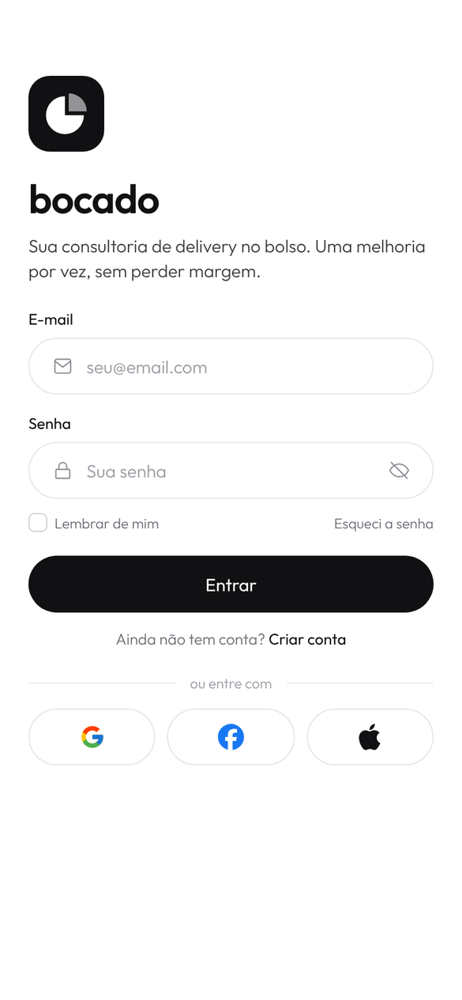
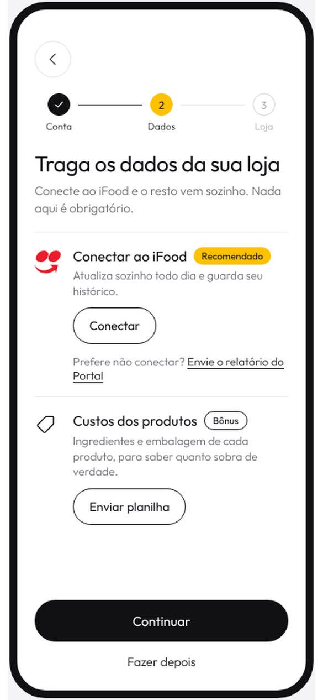
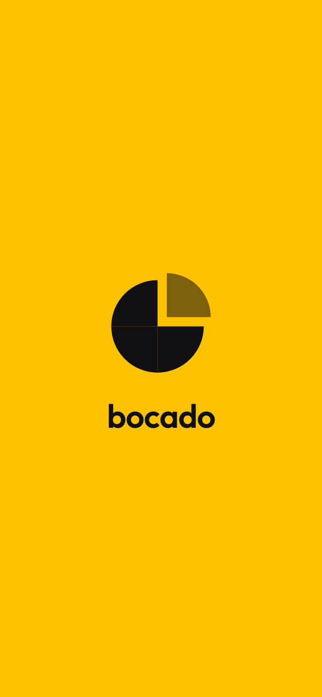
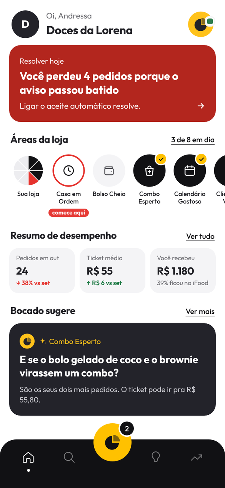

# bocado

> um bocado de cada vez

Bocado é um app de auto-consultoria com IA para donos de lojas pequenas no iFood. Ele lê os dados da loja, aponta o que atrapalha as vendas, sugere estratégias, acompanha testes de 15 dias e ajuda a decidir o próximo passo. A sensação é a de um consultor conversando de igual para igual, e não a de um painel de relatórios.

  
  
  
  

